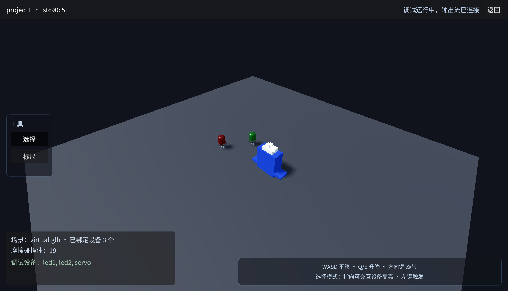
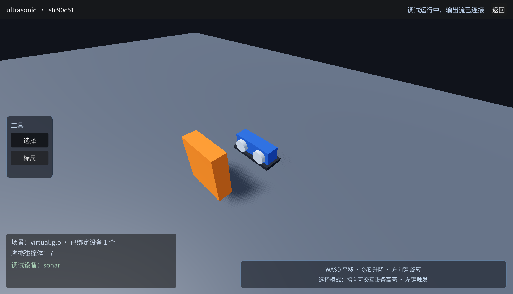
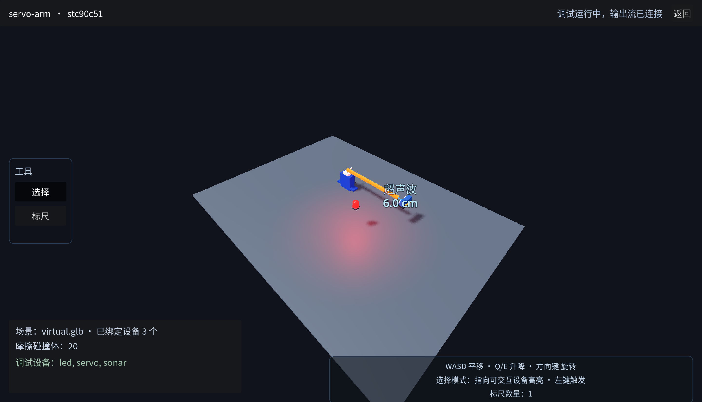
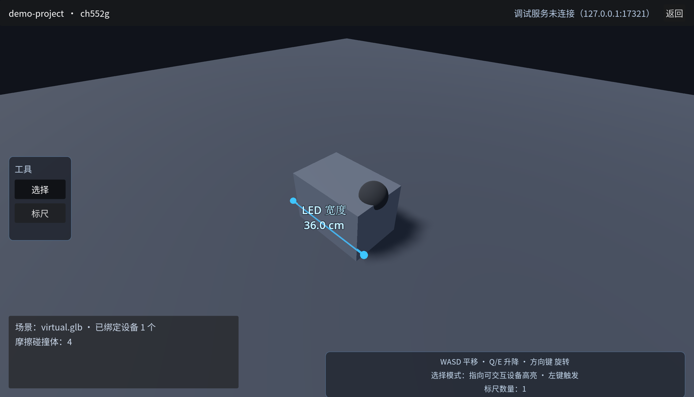

# hpm-virtual

HPM 虚拟仿真环境：Godot 4.7 程序打开 HPM 工程，加载 `virtual/` 下的 3D 场景，
连接 hpm-gui 调试服务，把调试输出交给设备包的外部脚本驱动模型动作。

## 快速开始

```bash
# 打开程序（欢迎页）
godot --path .

# 示例 1：一个舵机 + 两个 LED，固件控制舵机转动、LED 闪烁
godot --path . -- --project=examples/project1

# 示例 2：与示例 1 相同，但 led2 通过自定义虚拟包换成了可点击交互的 LED
godot --path . -- --project=examples/project2

# 示例 3：通用超声波距离传感器，进入有效距离后实时绘制标尺
godot --path . -- --project=examples/ultrasonic

# 示例 4：舵机带动长杆扫过右侧超声波，遮挡后 LED 亮
godot --path . -- --project=examples/servo-arm

# 示例 5：四轮步进小车 + 超声波避墙
godot --path . -- --project=examples/stepper-car

# 全部测试
tests/run_all.sh
```

示例工程都有对应的 Blender 文件：

```
examples/project1/virtual/virtual.blend
examples/project2/virtual/virtual.blend
examples/ultrasonic/virtual/virtual.blend
examples/servo-arm/virtual/virtual.blend
examples/stepper-car/virtual/virtual.blend
```

## 五个示例

| 工程 | 内容 |
| --- | --- |
| `examples/project1` | STC90C51 + 舵机(P1_0) + led1(P1_1) + led2(P1_2)。固件让舵机在 0°/90°/180° 之间转动，两个 LED 交替/同时闪烁。 |
| `examples/project2` | 与 project1 相同的固件和场景；`led2` 在 `virtual.json` 中 `override` 到自定义虚拟包 `clickable-led`，点击可切换红/蓝颜色。 |
| `examples/ultrasonic` | STC90C51 + 通用 `ultrasonic-*` 驱动（TRIG/ECHO）。debug 注册 `target_distance` 输入；`virtual.gd` 移动目标、射线测量并把 `distance` 写回；实测 `< 有效距离` 时实时更新标尺。 |
| `examples/servo-arm` | 舵机带动长杆从左侧扫到右侧；右侧超声波射线测量杆的位置。固件读回 `sonar_read_cm()`，实测距离 `<= 10 cm` 时点亮 LED。 |
| `examples/stepper-car` | 四个 `stepper-*` 步进电机驱动四轮小车；车头超声波检测墙，距离过近时先后退、再转向、继续前进。 |







构建与调试：

```bash
cd examples/project1      # 或 project2
hpm sync --offline
hpm build
./run.sh                  # 在 mcus 模拟器里验证
```

在虚拟环境里看效果：

1. `python3 main.py` 启动 hpm-gui，打开对应工程并「启动调试」。
2. 另开终端：
   ```bash
   godot --path . -- --project=examples/project1
   ```
3. Godot 自动连接调试服务，舵机与 LED 跟随固件动作。
4. 右键删除标尺、左键画标尺；选择模式下点击 project2 的 led2 可切换颜色。

## 目录

```
app/                  欢迎页、HUD、仿真视图
core/                 项目/包/模型/物理/调试服务/脚本宿主/标尺
sdk/virtual_device.gd 设备外部脚本基类（公开接口）
examples/project1     完整固件 + 虚拟场景 + virtual.blend
examples/project2     project1 + 自定义虚拟包（可点击 LED）
examples/ultrasonic   通用超声波驱动 + 有效距离标尺仿真
examples/servo-arm    舵机长杆遮挡超声波 -> LED
examples/stepper-car  四轮步进小车 + 超声波避墙
blender_addon/        Blender 插件（模型列表、拖入、摩擦/质量、自定义包、导出）
tools/                生成示例场景/Blender 文件、模拟调试服务、打包插件
tests/                冒烟/真实设备/覆盖包/PWM/标尺/交互/Blender 测试
docs/spec/            virtual.json / device.json / virtual.gd / 自定义虚拟包
```

## 操作

- **WASD** 水平平移，**Q/E** 升降，**方向键** 旋转视角。
- **选择模式**下按住鼠标右键拖动可旋转视角。
- 顶部“重置”按钮：重新加载 3D 场景、设备和标尺。
- 左侧半透明工具栏：
  - **选择**（V）：鼠标指向注册了交互的设备时高亮，左键触发交互。
  - **标尺**（M）：左键第一次设起点、第二次设终点；右键删除鼠标附近的标尺。
- 标尺是透明蓝色，自动显示 `m` / `cm`；可以同时画多条。
- 外部脚本可通过 `register_interaction()` 注册点击交互，通过
  `draw_ruler()` 画标尺，通过 `get_scene_root()` 读取整个场景，见
  [virtual.gd 规范](docs/spec/virtual-gd.md)。



## 工作方式

1. 打开项目 → 读 `project.json` 与 `virtual/virtual.json`。
2. `virtual/virtual.glb` 运行时用 `GLTFDocument` 从绝对路径加载（用户项目不是 `res://`）。
3. 每个网格节点生成独立 `StaticBody3D + PhysicsMaterial`，摩擦来自 `device.json`
   （设备）、`virtual.json`（场景/实例覆盖），实现“按物体分摩擦”。
4. 解析 `virtual.json.devices[].package` → 设备包 `debug/device.json`、`virtual.gd`；
   有 `override` 时优先使用自定义虚拟包。
5. 轮询 `GET /debugger` 检测会话；开始后连 `GET /outputs/stream`（SSE），
   按设备名把 `values` 分发给脚本；脚本 `send()/invoke()` 反向走 `POST /devices/input`。
6. 断线 1 秒后自动重连，会话结束自动复位脚本。

细节见 [开发方案](docs/development-plan.md) 与规范：
[virtual.json](docs/spec/virtual-json.md)、[device.json](docs/spec/device-json.md)、
[virtual.gd](docs/spec/virtual-gd.md)、[自定义虚拟包](docs/spec/custom-virtual-pack.md)。

## 设备包

设备虚拟资产直接安装在设备包里：

```
~/.hpm/packages/gpio-*-1.0.0/debug/
  debug.c        # LED 输出插件
  device.json    # 按物体摩擦/通道
  device.gltf    # LED 模型（buffer base64 内嵌，无 .bin）
  virtual.gd     # power -> 发光
~/.hpm/packages/pwm-stc90c51-1.0.0/debug/
  debug.c        # PWM 脉宽 -> 舵机角度
  device.json
  device.gltf    # SG90 风格舵机（buffer base64 内嵌，无 .bin）
  virtual.gd     # angle -> 摆臂旋转
~/.hpm/packages/ultrasonic-*-1.0.0/debug/
  debug.c        # target_distance 输入 + distance 实测回写
  device.json    # 物理质量/摩擦 + config 声明
  device.gltf    # 通用超声波模型（base64，无 .bin）
  virtual.gd     # 射线测量 -> send("distance")；< effective_distance 更新标尺
```

设备包的 `manifest.json` / `device.json` 可以声明 `config` 字段，类型为
`number` / `bool` / `string`；外部脚本用 `get_config("effective_distance")` 读取。
每个物体的 `physics` 现在同时支持 `friction` 和 `mass`。

重新生成设备模型：

```bash
godot --headless --path . --script res://tools/build_device_assets.gd
```

HPM 设备包内不允许二进制文件，因此 `device.gltf` 使用 base64 内嵌 buffer，
不会再生成 `device0.bin`。

示例场景和 Blender 文件由脚本生成：

```bash
godot --headless --path . --script res://tools/build_example_scenes.gd
godot --headless --path . --script res://tools/build_ultrasonic_assets.gd
blender --background --factory-startup --python tools/build_example_blends.py
```

## Blender 插件

```bash
tools/package_blender_addon.sh     # 生成 dist/hpm_virtual-*.zip
tests/run_blender_addon_test.sh    # 无头测试
```

安装后在 3D 视图侧栏 `HPM`：

1. 填项目目录 → 加载项目，得到设备模型列表。
2. 点“拖入场景”，模型跟随鼠标，左键放置。
3. 点模型行的“编辑”，弹窗里打开“使用自定义虚拟包”并填写文件夹；
   只影响之后拖入的实例，已有实例保持不变；关掉后新拖入恢复默认。
4. 选中网格编辑按物体摩擦。
5. 导出 `virtual/virtual.glb + virtual.json`，自定义包自动复制到项目的
   `virtual/packages/`。

自定义包可放在 `~/.hpm/virtual/` 或 `<项目>/virtual/packages/`。

所有 HPM 设备包使用 **MIT** 协议；本仓库自身使用 GPL-3.0-only。
详见 [blender_addon/README.md](blender_addon/README.md) 与
[自定义虚拟包规范](docs/spec/custom-virtual-pack.md)。

## 当前状态

已完成：欢迎页/最近项目、GLB 加载、按物体摩擦、包解析、外部脚本缓存加载、
调试会话探测、SSE 输出流与重连、输入写回、gpio/pwm 真实设备包、
PWM 调试插件、Blender 插件、自定义包运行时覆盖、五个完整示例工程、
相机控制、选择/标尺工具、场景读取与外部脚本标尺 API、Logo 启动画面。

未完成：HUD 通道控件、骨骼动画碰撞、正式打包发布、
原生 Asset Browser 拖拽（当前用“拖入场景”模态放置代替）。

## 设备包约定

```
<pkg>/
  manifest.json
  debug/
    debug.c         # 有它才需要做虚拟化
    device.json     # 模型、脚本、按物体摩擦参数
    device.gltf     # Blender 插件导入用
    virtual.gd      # extends "res://sdk/virtual_device.gd"
```

安装位置：`~/.hpm/packages`；开发时也支持 `$HPM_PACKAGES_DIR` 和项目内
`packages/`、`.hpm/packages/`。

## License

本项目使用 GNU General Public License v3.0 only（GPL-3.0-only），
见 [LICENSE](LICENSE)。
