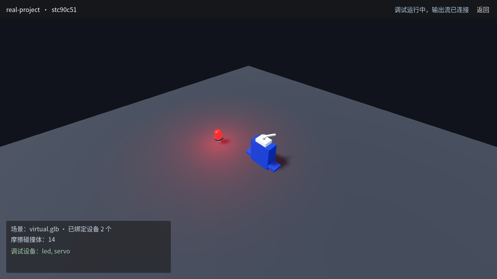
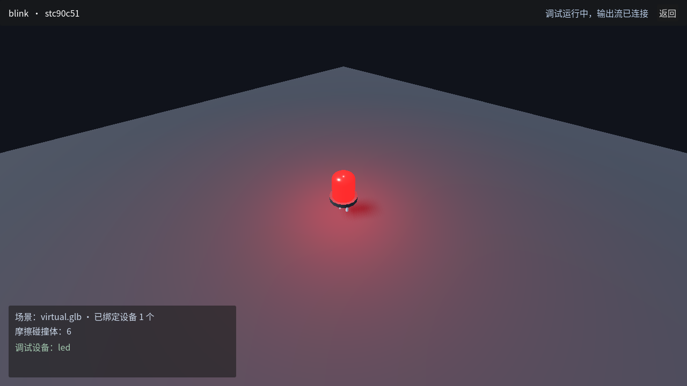

# hpm-virtual

HPM 虚拟仿真环境：Godot 4.7 程序打开 HPM 工程，加载 `virtual/` 下的 3D 场景，
连接 hpm-gui 调试服务，把调试输出交给设备包的外部脚本驱动模型动作。

## 快速开始

```bash
# 打开程序（欢迎页）
godot --path .

# 演示：内嵌设备包（不依赖 ~/.hpm）
godot --path . -- --project=examples/demo-project

# 真实设备包：gpio(LED) + pwm(舵机)，需要已安装的 ~/.hpm/packages
godot --path . -- --project=examples/real-project

# 完整闪烁工程：固件 + 虚拟场景（构建见 examples/blink/README.md）
cd examples/blink && ./run.sh

# 全部测试（Godot 43 + 18 + 9 项，PWM 8 项，Blink 固件，Blender 端到端）
tests/run_all.sh
# 也可以单独跑
godot --headless --path . --script res://tests/smoke_test.gd
godot --headless --path . --script res://tests/real_packages_test.gd
godot --headless --path . --script res://tests/override_test.gd
tests/run_pwm_plugin_test.sh
tests/run_blender_addon_test.sh
tests/run_blink_test.sh
```

用本地模拟服务看动画：

```bash
python3 tools/mock_debug_service.py "$PWD/examples/real-project" 18085 30 &
HPM_GUI_SERVICE_URL=http://127.0.0.1:18085 \
  godot --path . -- --project=examples/real-project
```



Blink 工程：`P1_0` 固件闪烁 → gpio 调试插件 → hpm-gui 输出流 → 虚拟 LED：



## 目录

```
app/                  欢迎页、HUD、仿真视图
core/                 项目/包/模型/物理/调试服务/脚本宿主
sdk/virtual_device.gd 设备外部脚本基类（公开接口）
examples/demo-project 自带设备包的演示工程
examples/real-project 使用真实 gpio/pwm 设备包的工程
examples/blink       完整固件工程：LED 闪烁 + 虚拟场景
blender_addon/        Blender 插件（模型列表、拖入、摩擦、自定义包、导出）
tools/                生成 GLB、模拟调试服务、打包插件
tests/                冒烟/真实设备/覆盖包/PWM/Blender 插件测试
docs/spec/            virtual.json / device.json / virtual.gd / 自定义虚拟包
```

## 工作方式

1. 打开项目 → 读 `project.json` 与 `virtual/virtual.json`。
2. `virtual/virtual.glb` 运行时用 `GLTFDocument` 从绝对路径加载（用户项目不是 `res://`）。
3. 每个网格节点生成独立 `StaticBody3D + PhysicsMaterial`，摩擦来自 `device.json`
   （设备）、`virtual.json`（场景/实例覆盖），实现“按物体分摩擦”。
4. 解析 `virtual.json.devices[].package` → 设备包 `debug/device.json`、`virtual.gd`。
5. 轮询 `GET /debugger` 检测会话；开始后连 `GET /outputs/stream`（SSE），
   按设备名把 `values` 分发给脚本；脚本 `send()/invoke()` 反向走 `POST /devices/input`。
6. 断线 1 秒后自动重连，会话结束自动复位脚本。

细节见 [开发方案](docs/development-plan.md) 与规范：
[virtual.json](docs/spec/virtual-json.md)、[device.json](docs/spec/device-json.md)、
[virtual.gd](docs/spec/virtual-gd.md)、[自定义虚拟包](docs/spec/custom-virtual-pack.md)。

## 真实设备包

设备虚拟资产**直接安装在设备包里**，不在本仓库留副本：

```
~/.hpm/packages/gpio-*-1.0.0/debug/
  debug.c        # LED 输出插件（已有）
  device.json    # 按物体摩擦/通道
  device.gltf    # 5mm LED 模型
  virtual.gd     # power -> 发光
~/.hpm/packages/pwm-stc90c51-1.0.0/debug/
  debug.c        # 新增：PWM 脉宽 -> 舵机角度
  device.json
  device.gltf    # SG90 风格舵机
  virtual.gd     # angle -> 摆臂旋转
```

重新生成模型到已安装的设备包：

```bash
godot --headless --path . --script res://tools/build_device_assets.gd
```

`debug.c` 会被 `hpm debug` 按包自动编译成插件；PWM 插件把引脚高电平占空比
（5%–10%）映射到 0–180°，虚拟舵机通过 `/outputs/stream` 的 `angle` 通道转动。

## Blink 完整示例

`examples/blink` 是端到端最小工程：

```bash
cd examples/blink
hpm sync --offline
hpm build
./run.sh          # CLI 模拟器里验证闪烁
```

在 Godot 里看效果：hpm-gui 打开 `examples/blink` 并启动调试，然后：

```bash
godot --path . -- --project=examples/blink
```

详见 [examples/blink/README.md](examples/blink/README.md)。

## Blender 插件

```bash
# 打包成可安装 zip
tools/package_blender_addon.sh
# 无头测试
tests/run_blender_addon_test.sh
```

安装后在 3D 视图侧栏 `HPM`：

1. 填项目目录 → 加载项目，得到设备模型列表。
2. 点“拖入场景”，模型跟随鼠标，左键放置。
3. 点模型行的“编辑”，弹窗里打开“使用自定义虚拟包”并填写文件夹；
   只影响之后拖入的实例，已有实例保持不变；关掉后新拖入恢复默认。
4. 选中网格编辑按物体摩擦。
5. 导出 `virtual/virtual.glb + virtual.json`，自定义包自动复制到项目的
   `virtual/packages/`。

详见 [blender_addon/README.md](blender_addon/README.md) 与
[自定义虚拟包规范](docs/spec/custom-virtual-pack.md)。

## 当前状态

已完成：欢迎页/最近项目、GLB 加载、按物体摩擦、包解析、外部脚本缓存加载、
调试会话探测、SSE 输出流与重连、输入写回、gpio/pwm 真实设备包、
PWM 调试插件、Blender 插件（模型列表/拖入/摩擦/自定义包/导出）、
自定义包运行时覆盖、Blink 完整固件工程、真实设备演示工程与测试。

未完成：HUD 通道控件与 3D 点击输入、骨骼动画碰撞、正式打包发布、
原生 Asset Browser 拖拽（当前用“拖入场景”模态放置代替）。

## 设备包约定

```
<pkg>/
  manifest.json
  debug/
    debug.c         # 有它才需要做虚拟化
    device.json     # 模型、脚本、按物体摩擦参数
    device.gltf     # Blender 插件导入用
    virtual.gd      # extends "res://sdk/virtual_device.gd"
```

安装位置：`~/.hpm/packages`；开发时也支持 `$HPM_PACKAGES_DIR` 和项目内
`packages/`、`.hpm/packages/`。
