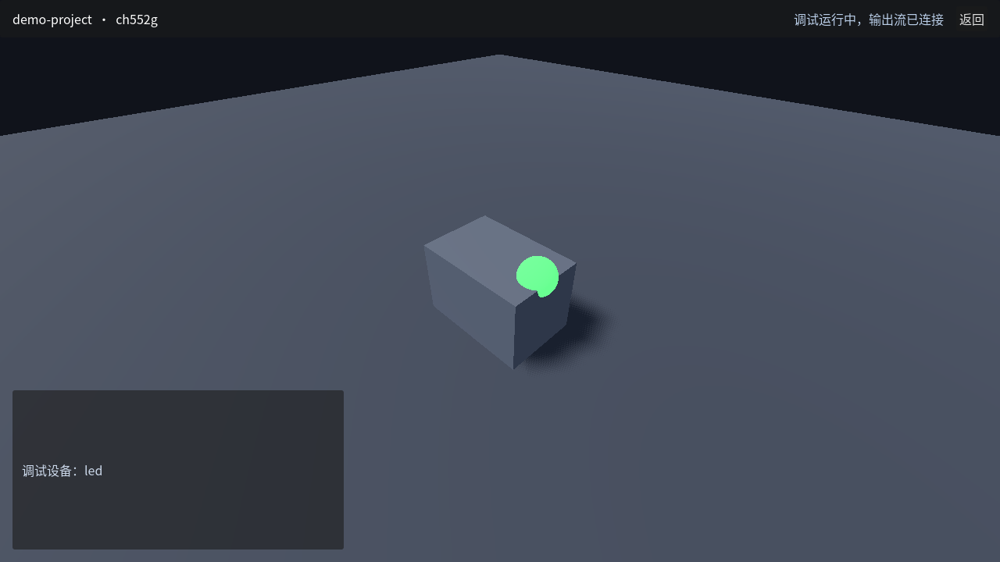

# hpm-virtual

HPM 虚拟仿真环境：Godot 4.7 程序打开 HPM 工程，加载 `virtual/` 下的 3D 场景，
连接 hpm-gui 调试服务，把调试输出交给设备包的外部脚本驱动模型动作。

## 快速开始

```bash
# 打开程序（欢迎页）
godot --path .

# 直接打开演示工程
godot --path . -- --project=examples/demo-project

# 无头测试（43 项）
godot --headless --path . --script res://tests/smoke_test.gd
```

演示工程自带设备包 `examples/demo-project/packages/led-demo-1.0.0`，不依赖
`~/.hpm/packages` 也能跑。要看到 LED 点亮，可启动一个 hpm-gui 调试会话，
或使用本地模拟服务：

```bash
python3 tools/mock_debug_service.py "$PWD/examples/demo-project" 18081 30 &
HPM_GUI_SERVICE_URL=http://127.0.0.1:18081 godot --path . -- --project=examples/demo-project
```




## 目录

```
app/                 欢迎页、HUD、仿真视图
core/                项目/包/模型/物理/调试服务/脚本宿主
sdk/virtual_device.gd 设备外部脚本基类（公开接口）
examples/demo-project 可直接运行的演示工程
tools/               无 Blender 生成 GLB 的脚本
tests/smoke_test.gd  无头冒烟测试
docs/spec/           virtual.json / device.json / virtual.gd 规范
```

## 工作方式

1. 打开项目 → 读 `project.json` 与 `virtual/virtual.json`。
2. `virtual/virtual.glb` 运行时用 `GLTFDocument` 从绝对路径加载（用户项目不是 `res://`）。
3. 每个网格节点生成独立 `StaticBody3D + PhysicsMaterial`，摩擦来自 `device.json`
   （设备）或 `virtual.json`（场景），实现“按物体分摩擦”。
4. 解析 `virtual.json.devices[].package` → 设备包 `debug/device.json`、`virtual.gd`。
5. 轮询 `GET /debugger` 检测会话；开始后连 `GET /outputs/stream`（SSE），
   按设备名把 `values` 分发给脚本；脚本 `send()/invoke()` 反向走 `POST /devices/input`。
6. 断线 1 秒后自动重连，会话结束自动复位脚本。

细节见 [开发方案](docs/development-plan.md) 与三份规范：
[virtual.json](docs/spec/virtual-json.md)、[device.json](docs/spec/device-json.md)、
[virtual.gd](docs/spec/virtual-gd.md)。

## 当前状态

已完成：欢迎页/最近项目、GLB 加载、按物体摩擦、包解析、外部脚本缓存加载、
调试会话探测、SSE 输出流与重连、输入写回、演示工程与无头测试。

未完成：Blender 插件（放置/摩擦编辑/导出）、真实设备包的 `device.json` 与
`virtual.gd`、HUD 通道控件、骨骼动画碰撞、打包发布。

## 设备包约定

```
<pkg>/
  manifest.json
  debug/
    device.json     # 模型、脚本、按物体摩擦参数
    device.gltf     # Blender 插件导入用
    virtual.gd      # extends "res://sdk/virtual_device.gd"
```

安装位置：`~/.hpm/packages`；开发时也支持 `$HPM_PACKAGES_DIR` 和项目内
`packages/`、`.hpm/packages/`。
